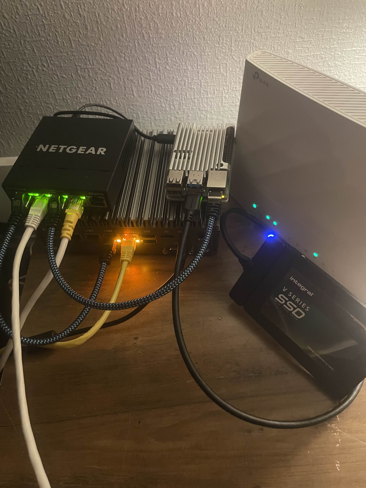

# Raspberry-Pi-NAS-Server
Project Overview

This project documents the deployment and configuration of a Network Attached Storage (NAS) server using a Raspberry Pi and a 1TB external SSD.

The NAS provides centralised file storage accessible from both Linux and Windows devices across a local network. Remote access is supported through a WireGuard VPN hosted on an OPNsense firewall.

The project demonstrates Linux system administration, storage management, network file sharing, firewall configuration and secure remote connectivity.

## Hardware Setup

  

## Hardware and Software

| Component | Description |
|---|---|
| NAS Server | Raspberry Pi |
| Operating System | Raspberry Pi OS |
| Storage | 1TB External SSD |
| Filesystem | ext4 |
| File Sharing | Samba (SMB) |
| Firewall / Router | OPNsense |
| VPN | WireGuard |
| Linux Client | CachyOS |
| Windows Client | Windows 11 |
