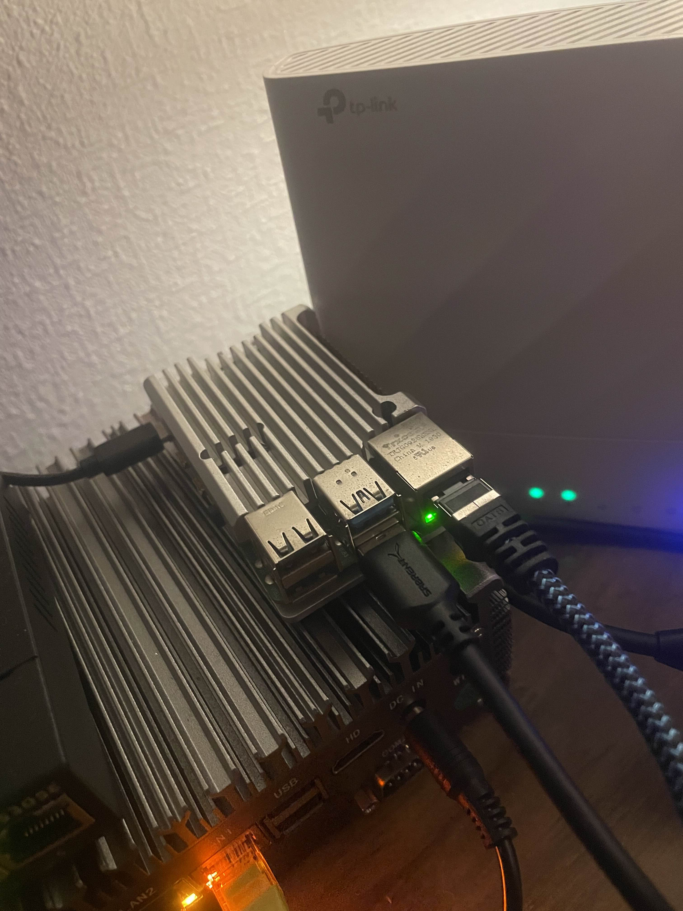
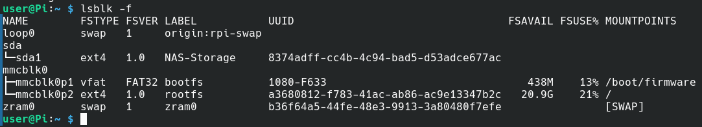
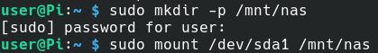
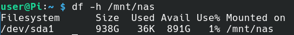
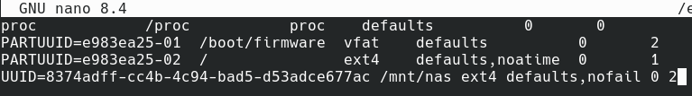

# 02 — Raspberry Pi Storage Mounting

## Overview

After preparing the 1TB SSD on CachyOS, the drive was connected to the Raspberry Pi through USB. The Raspberry Pi runs its operating system from a separate microSD card, allowing the external SSD to be dedicated to NAS storage.

The configuration was completed remotely using SSH.

## 1. Hardware Connection

The Raspberry Pi was connected to the home network through Ethernet, with the external SSD connected through USB.

<p align="center">
  
</p>

## 2. Remote SSH Connection

SSH was used to remotely access the Raspberry Pi from the CachyOS laptop.

```bash
ssh user@192.168.1.175
```

This allowed the Raspberry Pi to be configured without requiring a directly connected monitor or keyboard.

<p align="center">
  
</p>

## 3. Verify SSD Detection

The following command was used to identify the connected storage devices:

```bash
lsblk -f
```

The output confirmed that the external SSD was recognised as `/dev/sda1`, formatted as ext4 and labelled `NAS-Storage`.

The Raspberry Pi operating system was installed on the microSD card (`mmcblk0`).

<p align="center">
  
</p>

## 4. Create and Mount the Storage Directory

A dedicated mount directory was created for the NAS storage:

```bash
sudo mkdir -p /mnt/nas
```

The SSD was then mounted:

```bash
sudo mount /dev/sda1 /mnt/nas
```

<p align="center">
  
</p>

## 5. Verify Storage Capacity

The following command confirmed that the SSD was mounted successfully:

```bash
df -h /mnt/nas
```

The output showed that `/dev/sda1` was mounted at `/mnt/nas`, with approximately 938 GB of filesystem capacity.

<p align="center">
  
</p>

## 6. Configure Automatic Mounting

To ensure the SSD mounts automatically after a reboot, the `/etc/fstab` file was configured using the filesystem UUID.

First, a backup was created:

```bash
sudo cp /etc/fstab /etc/fstab.bak
```

The file was then edited:

```bash
sudo nano /etc/fstab
```

The following entry was added:

```fstab
UUID=8374adff-cc4b-4c94-bad5-d53adce677ac /mnt/nas ext4 defaults,nofail 0 2
```

Using the filesystem UUID ensures the correct SSD is identified even if its device name changes.

The `nofail` option allows the Raspberry Pi to continue booting if the SSD is disconnected.

<p align="center">
  
</p>

## 7. Verify Automatic Mounting

The configuration was tested using:

```bash
sudo systemctl daemon-reload
sudo umount /mnt/nas
sudo mount -a
```

The mount was then verified:

```bash
findmnt /mnt/nas
```

The output confirmed that the SSD was mounted at `/mnt/nas` using the ext4 filesystem with read/write permissions.

## Result

The Raspberry Pi successfully detected and mounted the external 1TB SSD.

Automatic mounting was configured through `/etc/fstab`, ensuring the storage is available after a system restart.

The next stage of the project involved configuring Samba to provide file sharing across the home network.
