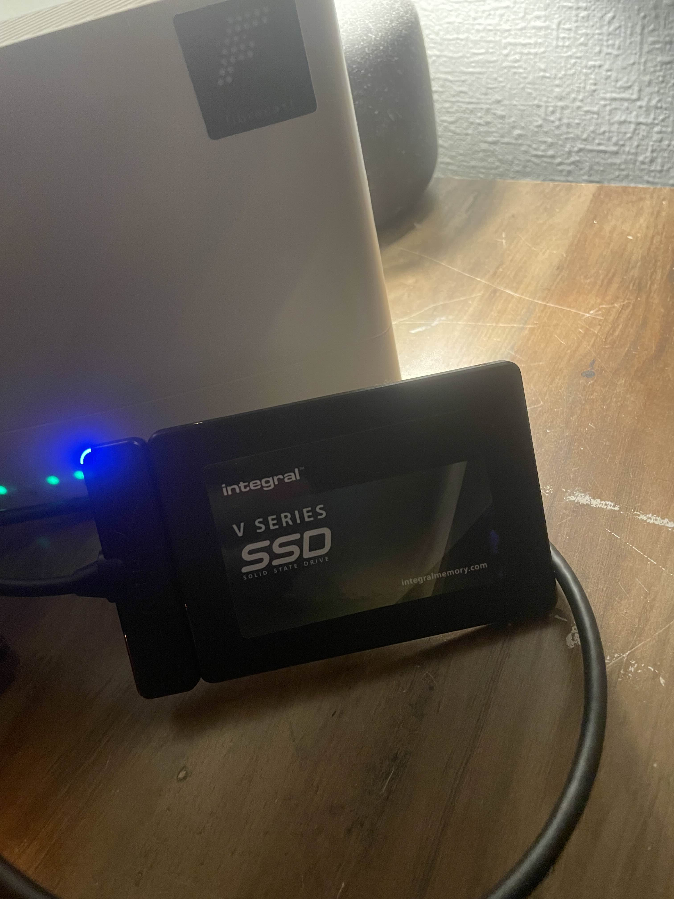
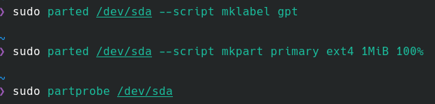
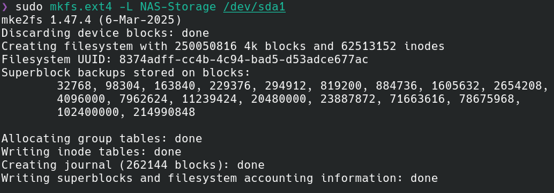

# 03 — SSD Preparation

## Overview

A 1TB external SSD was repurposed for use as the Raspberry Pi NAS storage device. The SSD previously contained a Raspberry Pi OS installation, which was removed before creating a new partition and formatting the drive with the ext4 filesystem.

The SSD was prepared using a CachyOS Linux laptop before being connected to the Raspberry Pi.

## 1. Storage Device

The external SSD provides approximately 1TB of storage for files shared across the home network.

<p align="center">
  
</p>

## 2. Partition Configuration

The existing Raspberry Pi OS partitions were unmounted and their filesystem signatures removed using `wipefs`.

A new GPT partition table was created, followed by a single partition occupying the available SSD capacity.

```bash
sudo wipefs -a /dev/sda
sudo parted /dev/sda --script mklabel gpt
sudo parted /dev/sda --script mkpart primary ext4 1MiB 100%
sudo partprobe /dev/sda
```

<p align="center">
  
</p>

## 3. Filesystem Formatting

The new partition was formatted using the ext4 filesystem and assigned the label `NAS-Storage`.

```bash
sudo mkfs.ext4 -L NAS-Storage /dev/sda1
```

ext4 was selected because it provides native Linux support, journaling and filesystem permissions suitable for a NAS server.

Windows compatibility is provided through Samba rather than direct access to the ext4 filesystem.

<p align="center">
  
</p>

## 4. Filesystem Verification

The following command was used to verify the newly created filesystem:

```bash
lsblk -f /dev/sda
```

The output confirmed that `/dev/sda1` was formatted as ext4 and labelled `NAS-Storage`.

<p align="center">
  
</p>

## Result

The SSD was successfully prepared with a GPT partition table and a single ext4 partition.

The drive was then ready to be connected to the Raspberry Pi for mounting and network file sharing.
