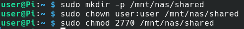
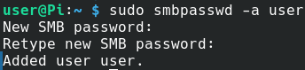
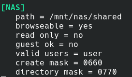
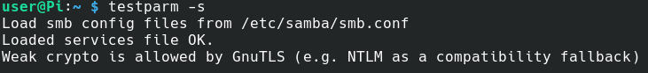
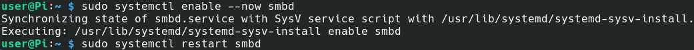
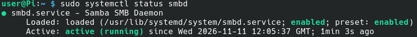

# 03 — Samba Configuration

## Overview

Samba was installed and configured on the Raspberry Pi to provide network file sharing between Linux and Windows devices.

Samba implements the Server Message Block (SMB) protocol, allowing both operating systems to access files stored on the external 1TB SSD.

The NAS was configured with authenticated access, restricted guest permissions and a dedicated shared directory.

## 1. Install Samba

The Raspberry Pi package repositories were updated before installing Samba.

```bash
sudo apt update
sudo apt install samba -y
```

<p align="center">
  
</p>

<p align="center">
  
</p>

## 2. Create the Shared Directory

A dedicated directory was created on the mounted SSD to store files shared across the network.

```bash
sudo mkdir -p /mnt/nas/shared
```

Ownership of the directory was assigned to the Raspberry Pi user:

```bash
sudo chown user:user /mnt/nas/shared
```

Directory permissions were configured:

```bash
sudo chmod 2770 /mnt/nas/shared
```

The `2770` permissions allow the owner and group full access, prevent access by other local users, and apply the setgid bit so newly created files and directories inherit the directory's group.

<p align="center">
  
</p>

## 3. Configure Samba Authentication

A Samba password was created for the existing Raspberry Pi user.

```bash
sudo smbpasswd -a user
```

This password is used when accessing the NAS from Windows or Linux clients.

The Samba account provides authenticated access to the network share without enabling anonymous guest access.

<p align="center">
  
</p>

## 4. Configure the Samba Share

Before modifying the Samba configuration, a backup of the original configuration file was created.

```bash
sudo cp /etc/samba/smb.conf /etc/samba/smb.conf.bak
```

The configuration file was then opened:

```bash
sudo nano /etc/samba/smb.conf
```

The following share definition was added:

```ini
[NAS]
   path = /mnt/nas/shared
   browseable = yes
   read only = no
   guest ok = no
   valid users = user
   create mask = 0660
   directory mask = 0770
```

### Configuration Explanation

| Setting | Purpose |
|---|---|
| `[NAS]` | Name of the network share |
| `path` | Location of shared files on the SSD |
| `browseable = yes` | Allows the share to appear when browsing the server |
| `read only = no` | Enables file creation and modification |
| `guest ok = no` | Disables unauthenticated guest access |
| `valid users = user` | Restricts access to the specified Samba user |
| `create mask = 0660` | Limits permissions for newly created files |
| `directory mask = 0770` | Limits permissions for newly created directories |

<p align="center">
  
</p>

## 5. Validate the Samba Configuration

The configuration was checked using:

```bash
testparm -s
```

The output confirmed that the Samba configuration loaded successfully.

This verifies that Samba accepts the configuration syntax, although it does not independently confirm network connectivity or user access.

<p align="center">
  
</p>

## 6. Enable and Start Samba

The Samba service was enabled to start automatically when the Raspberry Pi boots.

```bash
sudo systemctl enable --now smbd
```

The service was then restarted to apply the configuration.

```bash
sudo systemctl restart smbd
```

<p align="center">
  
</p>

## 7. Verify Samba Service Status

The service status was checked using:

```bash
sudo systemctl status smbd
```

The output confirmed that the Samba daemon was enabled and running successfully.

```text
Loaded: loaded (...; enabled; preset: enabled)
Active: active (running)
```

<p align="center">
  
</p>

## Result

Samba was successfully installed and configured on the Raspberry Pi.

The NAS now provides an authenticated SMB network share using the directory `/mnt/nas/shared` on the external SSD.

The share is accessible over the local network using:

**Linux:**
```text
smb://192.168.1.175/NAS
```

**Windows:**
```text
\\192.168.1.175\NAS
```

Remote access is also supported through the existing OPNsense WireGuard VPN, subject to the configured firewall permissions.

The following documentation sections cover client access and remote connectivity.
