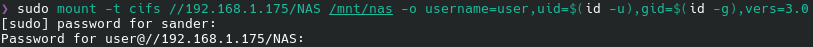
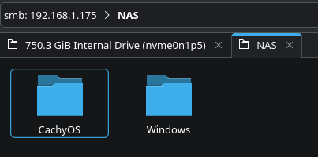
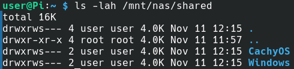

# 04 — Linux Client Access

## Overview

Following the installation and configuration of Samba on the Raspberry Pi, the NAS was accessed from a CachyOS Linux laptop.

The connection was established using the SMB protocol, allowing the laptop to access and manage files stored on the Raspberry Pi's external 1TB SSD.

## 1. Mount the NAS Using SMB

The Samba share was mounted from the CachyOS terminal using the CIFS filesystem driver.

```bash
sudo mount -t cifs //192.168.1.175/NAS /mnt/nas -o username=user,uid=$(id -u),gid=$(id -g),vers=3.0
```

The command specifies the NAS network address, local mount directory, Samba username and SMB protocol version.

The `uid` and `gid` options map the mounted files to the current Linux user's identifiers for local permission handling.

The command prompted for authentication credentials before establishing the connection.

<p align="center">
  
</p>

## 2. Access the NAS Through Dolphin

After connecting to the Samba share, the NAS files were accessed using the Dolphin file manager.

The NAS contained two folders created during testing:

- `CachyOS`
- `Windows`

These folders demonstrate how the same shared storage can be organised and accessed by different operating systems.

<p align="center">
  
</p>

The NAS can also be accessed directly through Dolphin using:

```text
smb://192.168.1.175/NAS
```

This provides a graphical method of accessing the share without manually mounting it through the terminal.

## 3. Verify Files on the Raspberry Pi

To confirm that folders created through the Linux client were stored on the Raspberry Pi, the following command was executed through SSH:

```bash
ls -lah /mnt/nas/shared
```

The output displayed the `CachyOS` and `Windows` directories, confirming that both were present on the NAS filesystem.

<p align="center">
  
</p>

## 4. Network Configuration

| Setting | Configuration |
|---|---|
| Linux Client | CachyOS |
| NAS Server | Raspberry Pi |
| NAS IP Address | 192.168.1.175 |
| Share Name | NAS |
| Protocol | SMB 3.0 |
| Network Share | `//192.168.1.175/NAS` |
| Server Storage Path | `/mnt/nas/shared` |

## Result

The CachyOS laptop successfully accessed the Raspberry Pi NAS through Samba.

The shared folders were visible through Dolphin and verified directly on the Raspberry Pi, demonstrating network file sharing between the Linux client and the NAS server.

The next stage documents accessing the same network share from a Windows 11 computer.
