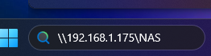
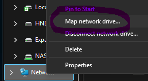
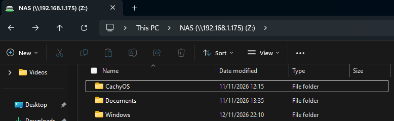

# 05 — Windows Client Access

## Overview

Following the successful configuration of Samba on the Raspberry Pi, the NAS was accessed from a Windows 11 computer.

The SMB protocol allows Windows to access files stored on the Raspberry Pi's external 1TB SSD without requiring additional filesystem drivers.

The NAS was also mapped as a network drive, providing convenient access through Windows File Explorer.

## 1. Connect to the NAS

Windows File Explorer was opened, and the NAS network address was entered into the address bar.

```text
\\192.168.1.175\NAS
```

The address identifies the Raspberry Pi NAS server and its configured Samba share.

Windows uses the SMB protocol to communicate with the Raspberry Pi over the local network.

<p align="center">
  
</p>

## 2. Map the NAS as a Network Drive

To provide easier access, the Samba share was mapped as a network drive in Windows.

The **Map network drive** option was selected from File Explorer.

<p align="center">
  
</p>

The following configuration was used:

| Setting | Configuration |
|---|---|
| Drive Letter | Z: |
| Network Location | `\\192.168.1.175\NAS` |
| Authentication | Samba username and password |
| Protocol | SMB |
| Server | Raspberry Pi NAS |

Mapping the network share allows the NAS to appear alongside local storage devices in Windows File Explorer.

## 3. Verify NAS Access

After mapping the network drive, the NAS appeared in File Explorer as:

```text
NAS (\\192.168.1.175) (Z:)
```

The shared directories were visible, including folders created from both the CachyOS Linux laptop and Windows computer.

<p align="center">
  
</p>

This confirmed that Windows could access the same centralised storage used by the Linux client.

## 4. Network Configuration

| Component | Configuration |
|---|---|
| Operating System | Windows 11 |
| NAS Server | Raspberry Pi |
| NAS IP Address | 192.168.1.175 |
| Share Name | NAS |
| Network Protocol | SMB (TCP 445) |
| Mapped Drive | Z: |
| Storage Filesystem | ext4 |

Although Windows does not natively support ext4, Samba allows files to be accessed over the network without requiring Windows to interact directly with the underlying filesystem.

## Result

The Raspberry Pi NAS was successfully accessed from Windows 11 using SMB.

The network share was mapped as drive Z:, providing convenient access to the external SSD through File Explorer.

The Windows and CachyOS clients were able to access the same shared directories, demonstrating cross-platform file sharing through the Raspberry Pi NAS.
