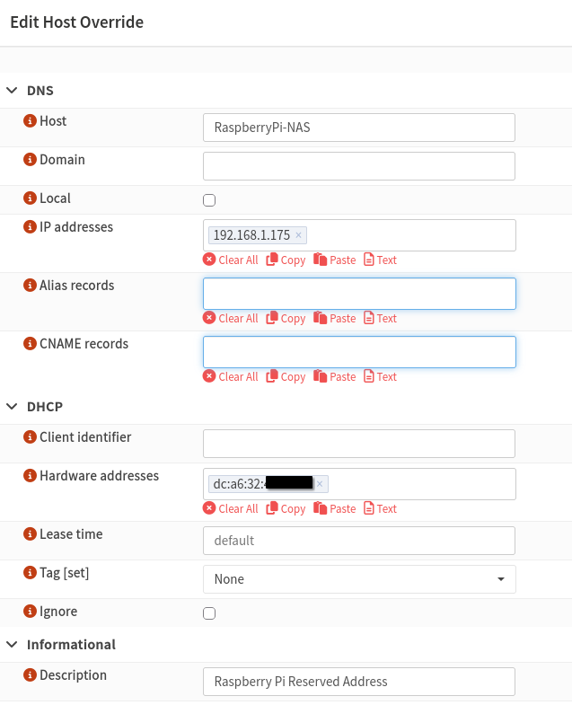

# 06 — OPNsense and WireGuard Configuration

## Overview

The Raspberry Pi NAS was integrated into the existing home network managed by an OPNsense firewall.

OPNsense was configured to associate the Raspberry Pi with a consistent local IP address, while the existing WireGuard VPN provides secure remote connectivity.

A dedicated firewall rule was also created to permit SMB traffic from the CachyOS laptop to the NAS.

## 1. Raspberry Pi IP Address Reservation

The Raspberry Pi NAS was assigned the local IP address `192.168.1.175`.

A host override was configured in OPNsense through:

**Services → Dnsmasq DNS & DHCP → Hosts**

The configuration associates the Raspberry Pi's Ethernet MAC address with its designated IP address.

| Setting | Configuration |
|---|---|
| Host | RaspberryPi-NAS |
| IP Address | 192.168.1.175 |
| Interface | LAN |
| DHCP Identification | Raspberry Pi Ethernet MAC address |
| Description | Raspberry Pi Reserved Address |

This configuration is intended to keep the NAS accessible at a consistent IP address, preventing its network location from changing when DHCP leases are renewed.

<p align="center">
  
</p>

## 2. WireGuard Remote Access

The existing WireGuard VPN hosted on OPNsense was used to provide remote access to the NAS without exposing SMB directly to the internet.

The CachyOS laptop connects through WireGuard using split tunnelling, allowing access to the home network while other internet traffic uses the laptop's normal connection.

### Network Configuration

| Component | Address |
|---|---|
| Home LAN | 192.168.1.0/24 |
| Raspberry Pi NAS | 192.168.1.175 |
| WireGuard Network | 10.10.10.0/24 |
| CachyOS VPN Client | 10.10.10.2/32 |
| NAS SMB Port | TCP 445 |

## 3. OPNsense SMB Firewall Rule

A dedicated firewall rule was configured under:

**Firewall → Rules → HomeVPN**

The rule permits the CachyOS WireGuard client to access the Raspberry Pi NAS using SMB.

| Setting | Configuration |
|---|---|
| Action | Pass |
| Interface | HomeVPN |
| Direction | In |
| Protocol | IPv4 TCP |
| Source | 10.10.10.2/32 |
| Destination | 192.168.1.175/32 |
| Destination Port | 445 |
| Description | Allow WireGuard SMB to Raspberry Pi NAS |

This rule explicitly permits SMB traffic from the authorised WireGuard client to the NAS.

The existing CachyOS allow-all firewall rule also permits this traffic. The dedicated SMB rule therefore provides clearer documentation and allows more granular access control if the broader rule is restricted in the future.

## 4. Remote NAS Access

Once connected to WireGuard, the CachyOS laptop can access the NAS using its local IP address.

The SMB connection can be tested using:

```bash
nc -vz 192.168.1.175 445
```

The NAS can then be accessed through Dolphin using:

```text
smb://192.168.1.175/NAS
```

Alternatively, the SMB share can be mounted using CIFS:

```bash
sudo mount -t cifs //192.168.1.175/NAS /mnt/nas -o username=user,uid=$(id -u),gid=$(id -g),vers=3.0
```

The Samba password is requested during authentication.

## 5. Security Considerations

The NAS was configured with several security measures:

- **WireGuard VPN:** Provides encrypted remote connectivity to the home network.
- **SMB Authentication:** Requires a valid Samba username and password.
- **Firewall Rules:** Controls access to the NAS through the HomeVPN interface.
- **No Public SMB Exposure:** TCP port 445 is not forwarded directly from the internet to the NAS.
- **Restricted Share Access:** Samba guest access is disabled, and access is limited to the configured user.

## Result

The Raspberry Pi NAS was integrated with the existing OPNsense and WireGuard infrastructure.

The NAS has a configured local network address and an explicit SMB firewall rule for the CachyOS VPN client.

This setup supports centralised file sharing across Windows and Linux devices, with remote access available through the existing VPN configuration.
